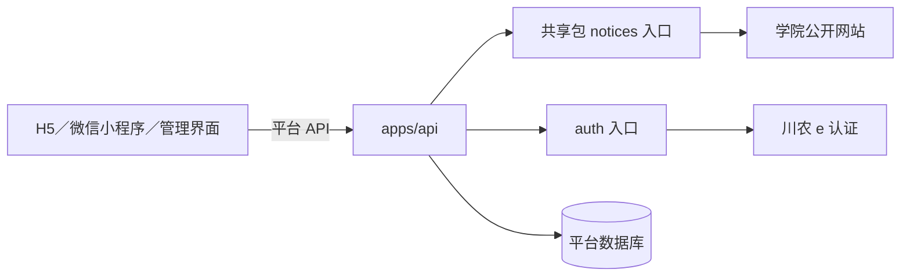

# 川农采集与认证共享包架构说明

## 赛事分类、字段证据与人工核对（#176）

`classifyNotice(title, paragraphs, attachmentTitles?)` 为站点无关的纯规则入口，返回 `definite`／`suspected`／`non_competition`、通知种类、规则版本、命中／排除理由与审核优先级。分类与 `pending/approved/rejected/imported` 审核状态独立。报名和变更优先（0），其他明确赛事其次（1），疑似（2）、非赛事（3）分别筛选；队列按优先级、抓取时间降序、ID稳定排序。新闻／获奖不证明开放报名，征文／作品征集不凭一个词确认赛事。名单排除先于分类；正文也检查名单标识。

runner 在现有来源、路径和预算内读取通知正文，取消标题预筛的过早丢弃。附件标题参与分类；有未核对附件的普通通知至少保留疑似，不在受控解析前清空附件。明确非赛事只保留标题、URL、发布日期、分类和安全理由，正文、附件链接、原始响应不持久化；人工恢复疑似仍使用原候选链，缺失信息需人工核对或在已有预算内重新获取。此策略增加普通通知正文检查的网络成本，不扩大栏目、主机、并发或请求预算，不能据此声称全院通知覆盖率已提高。

`parseEvidenceCandidate` 消费 HTML 快照和已安全提取的 PDF／DOCX 片段。每个自动字段保留来源 URL、通知版本、附件版本及页／段落；HTML 段落从0起，标题／元数据为-1，PDF页和DOCX段落从1起。资格标题与下一段跨来源时保持未知，不把拼接文字伪装成单一来源。不同来源或条款的主办、资格、人数、模式和时间候选保留 `fieldConflicts` 与双方证据；不按附件日期或更晚截止自动选值。多赛段／多赛道保留定位并将不能安全归属的整体时间置未知。仅日期不补时刻；相对时间无锚点不推算；跨年、正文年份和发布日期冲突保留核对理由。跨通知届次、赛段和转载关系只沿现有审核建议人工确认，不自动写正式关系。

`0012_ingestion_classification.sql` 增加当前分类、规则版本、提取键、优先级和两种历史：不可变提取修订、人工分类修订。键由通知版本、证据修订和规则版本组成；HTML 304 也基于已有快照刷新规则，不额外请求外网。相同键重跑不改修订，换规则追加历史并使旧批准失效，既有人工审核历史和正式数据保留。附件版本／状态变化与字段刷新在同一通知→候选锁序事务中完成，复用 #175 的证据校验。名单隐私擦除是历史不可变性的安全例外，连同提取历史和审核快照中的自动字段／摘录一并擦除。

迁移保留旧候选为 `ruleVersion=legacy`、`classification=suspected`，不猜旧记录分类，也不在迁移中触发外网。维护者可运行 `pnpm --filter @hehuoda/api ingestion reextract --candidate <id>`，只读取已有正文／附件快照；没有快照的字段仍未知。原两院静态来源配置和正式比赛公开契约保持兼容，回退应用时保留新增列／历史表，不做破坏性 down，不删除正式内容或审核材料。

管理 HTTP 延续 `/api/v1/admin/ingestion`：

- `GET /candidates` 增加 `classification`、`kind`（通知种类）、`needsReview=true/false`、`attachmentStatus`、`collegeId`（来源所属学院）、`channelId` 筛选。`status`仍表示审核状态；默认20、上限50；返回规则版本、优先级、定位字段证据及当前筛选下分类数量。详情提供完整冲突和最近50条提取／分类历史。
- `POST /candidates/:id/classification` 接收 `classification/baseline/operationId/reason`，复用可信管理员会话、Origin／CSRF、幂等和同事务审计。返回分类、审核状态和新候选修订；改分类使旧确认失效。已拒绝候选须先走 #40 重开；已导入候选不允许借分类变化撤销正式比赛。非赛事须先恢复分类才能批准。
- `PUT /candidates/:id/review` 继续提交人工材料，以 `checkedAt/resolution` 说明冲突解决并绑定当前证据，不覆盖冲突历史。附件字段证据沿用 format=2 的定位结构。400参数、404对象、409过期基线／状态／重复ID异参、401／403授权语义延续既有实现，契约由 DTO 生成到 OpenAPI／共享类型。

固定语料为人工指定标签的构造最小文本：五类各10个报名正例、25个非赛事、15个易混淆例、10个变更例，共100份；另有时间、资格和来源定位边界测试。它们是离线规则回归，不是官网样本统计，不能外推全站准确率或漏收率。实站抽样和运营效果由 #179 验收。没有引入 AI／OCR、自动发布或新的客户端依赖；管理页面接入属于 #177，学生端仍消费正式比赛 API，服务端成功不表示 H5／小程序外链或真机验收完成。

- 状态：**公开通知内核与认证入口已实现；平台校园核验 API 由 #135 接入**。
- 确认日期：2026-10-25（Asia/Shanghai）。
- 说明记录：[Issue #127](https://github.com/HeHuoDa/HeHuoDa/issues/127)（架构说明，非开发任务）。
- 实施任务：[Issue #129](https://github.com/HeHuoDa/HeHuoDa/issues/129)（两院公开通知抽包）、[Issue #134](https://github.com/HeHuoDa/HeHuoDa/issues/134)（学校认证适配）。
- 用途：记录共享包的现行职责、接口与调用边界。

## 当前能力与目标

公开抓取与解析内核位于 `packages/sicau-connectors/src/notices`，API 的调度与持久化仍位于 `apps/api/src/ingestion`。当前仅接入信息工程学院、生命科学学院的公开 HTML 通知。采集生成候选和原文证据，经人工核对、导入及显式发布后，用户端通过比赛 API 查询正式数据；打开平台比赛详情不会每次触发官网爬取。

川农 e 认证契约来自 [#130 的研究交付](https://github.com/HeHuoDa/HeHuoDa/issues/130#issuecomment-6384062301)，其中记录了真实账号正常登录和可信主体字段。2026-10-25，用户在 #134 开发会话中确认此前剩余的云端后端可达性与小程序承接已验证，尚未补录跟踪器；这是用户提供的前置确认，不是本轮实现测试的实站、模拟器或真机证据。包的离线验证不代表平台核验已经上线，也不证明本科、当前在读、真实姓名或学校背书。

公开通知采集内核与校园模拟登录适配使用仓库内部私有 Node.js workspace 包的两个独立入口。27 院来源扩展继续由 [Issue #49](https://github.com/HeHuoDa/HeHuoDa/issues/49) 跟踪，抽包完成不等于完成学院覆盖。

## 包结构与使用范围

| 项目       | 已确认选择                                                            |
| ---------- | --------------------------------------------------------------------- |
| 包名       | `@hehuoda/sicau-connectors`                                           |
| 目标位置   | `packages/sicau-connectors`                                           |
| 可见性     | `private: true`，首期不发布到 npm registry                            |
| 仓库内依赖 | 通过 `workspace:*` 声明                                               |
| 运行环境   | 服务端 Node.js，沿用项目运行环境约束                                  |
| 公开入口   | `@hehuoda/sicau-connectors/notices`、`@hehuoda/sicau-connectors/auth` |
| 调用者     | `apps/api` 与仓库内 Node 工具                                         |

当前目录：

```text
packages/sicau-connectors/
  src/notices/    已实现的公开通知抓取与解析
  src/auth/       独立的学校认证会话、协议与传输
  test/           离线行为测试与构建入口测试
  dist/notices/   ESM JavaScript 与 .d.ts 构建产物（忽略）
  dist/auth/      认证 ESM JavaScript 与 .d.ts 构建产物（忽略）
```

`/notices` 导出来源、受控 HTTP、HTML 解析与候选类型，指向 ESM JavaScript 构建产物和类型声明，由调用方显式依赖；包不反向导入 `apps/api` 或其他 `apps/*` 的内部源码，不绑定 NestJS、数据库连接和平台账号模型。

## 界面与后端的调用关系



H5、小程序和管理界面不直接导入或执行爬虫。现有采集依赖 Node HTTPS、DNS 等服务端能力；抽包不会使这些能力变成浏览器或小程序 API。前端继续通过平台 HTTP 接口及生成类型获取数据，不持有学校 Cookie 或认证票据。

## notices：公开通知抓取与解析

包内职责：

- 经过核验的来源定义、学院适配器与页面选择器。
- 公开通知列表、分页、正文、发布日期和附件链接解析。
- 来源访问限制、请求预算、取消、响应大小和编码处理等抓取能力。
- 比赛候选字段、缺失信息、冲突提示及原文证据提取。
- 与公开接口对应的离线样本和维护型源码测试。

API 继续负责数据库锁、任务调度、游标和恢复链、运行记录、通知版本与候选持久化、人工审核、导入及显式发布。包返回上游内容和候选结果，不直接修改或发布正式比赛。

### 多栏目底座与持续扫描（#174）

`Source` 增加目录 `collegeId`、`defaultChannelId` 和只读 `channels`。稳定来源 ID、旧 `listUrl`、适配版本和 Article 返回结构保持兼容：`life-sciences` 仍是来源 ID，对应目录学院 `life-science`。不传栏目时，`extractList`／`extractArticle` 使用默认栏目；第四个参数可选择该来源已注册的栏目 ID。当前正式注册仍为原两院默认栏目，同站第二栏目的支持通过最小离线样例验证。

`vsb-selectors` 适配器以仓库中的选择器、通知路径、分页路径和日期规则解析页面，不再按学院名称分支。默认使用 next-link；可配置 `pagination.mode=numbered`，从两个明确选择器读取当前／总页数，再生成路径模板或查询参数。`datePattern` 的前三个捕获组分别为完整年、月、日，缺年份仍未知。配置在模块载入时校验；新增配置必须经代码审阅，管理写接口不能修改主机、选择器、路径和适配器。管理来源查询的 OpenAPI 同步声明这些只读定义。

公开请求除 HTTPS 主机限制外，仅允许注册的列表／通知路径以及 `/robots.txt`，每次重定向同样检查；有业务意义的查询参数仍保留。列表输出还校验所选栏目的通知与下一页路径，拒绝自循环。适配器只有明确配置 `empty` 标记且页面有分页容器时才确认空栏目；选择器失效、分页失效、拦截页和空正文以 `NoticeParseError.code` 区分。无完整发布日期仍返回 `null`，不猜年份；runner 在运行结果分别记录 `missing-list-date`／`missing-article-date`，`kind=diagnostic` 不增加失败计数。解析错误的安全代码与说明随运行结果保存，网络／数据库错误继续脱敏。

`0009_ingestion_channels.sql` 增加栏目状态、通知栏目关联、扫描任务和调度轮。旧来源、通知、版本、候选、审核映射及运行 ID／JSON 游标原样保留；生命科学学院不改来源 ID。默认栏目继承来源预算，显式栏目设置可覆盖；原两院保留原默认栏目可用性，但没有因此伪造人工核验通过。其他静态新增栏目默认关闭。兼容触发器为回退应用新插入的来源补默认栏目，旧 `scan({sourceId})`、CLI 审核与源预算设置仍可使用。回退时关闭新版调度并保留所有新增表，不执行破坏性 down。

定时入口仍为北京时间 09:00／18:00。`ChannelRoundRunner` 协调每轮，所有网络工作片仍调用持有同源／全局锁的 `IngestionRunner`，并发保持 1。先按持久轮转顺序给每个启用、非退避栏目一次首页检查机会，再为未完成 fresh、backfill、revisit、retry 任务分配剩余预算；每任务本轮取得有限工作片后让出。默认每轮上限 200 请求、15 分钟，单片最多 10 请求／1 列表页，并受更紧的来源／栏目预算限制。requests 包含 robots、重定向与重试；字节为实际压缩传输接收量，包含超限或取消前已收到部分。纯页数／请求／时长耗尽保存 partial，不增加官网失败退避。

四阶段的任务和游标分别保存。fresh 范围仅首页及其通知，同轮恢复原任务；新轮独立建立首页检查任务，旧积压仍可续跑而不改写旧范围。backfill 首次按本次启用日期向前 365 天固定为含首尾 366 天；revisit 按栏目已知通知取得最多 150 条的明确快照，下一快照从最久未检查的通知开始；retry 同时接续已知失效通知和失败叶运行中尚未写入通知表的 URL。配置指纹改变会拒绝旧任务，须以原任务 ID 显式重建；`rebuild_of` 及轮次／阶段唯一约束防止中断后重复后继。旧通知遇到新候选时仍按来源 ID＋规范化 URL 维护一条版本／候选链，多栏目仅增加关联。

运行结果与任务终态、游标及预算同事务提交，避免成功运行对应的任务仍永久处于 running。每次传输尝试前先持久化请求额度，响应／异常时再刷新已知下载量；进程中断的在途请求按已预留额度保守计数，不据此推断官网已收到请求。调度重启从各运行的持久用量及任务引用重建本轮预算，即使轮汇总尚未落账也不重置额度。backfill 的自定义日期只有匹配启用日固定范围才可受理，普通自定义范围继续使用无 phase 的旧扫描。未建立状态行的新栏目即使 preview 也禁止联网。

预算作用域为一次受理扫描或一次明确的调度轮，轮内所有片累计使用同一额度。API／CLI 手动扫描、预览和整个调度轮共享协调锁，调度轮期间 HTTP 受理返回 409、CLI 返回 locked，手动任务不能插入轮内工作片之间另取预算；本轮结束后再执行独立受理的范围。协调锁之外，每个实际网络执行仍取得同源／全局网络锁。

官网失败按栏目保存 15／30／60／120／240／360 分钟退避，最多 6 小时；有效成功检查重置。每轮记录 dueAt、nextDueAt、startedAt、finishedAt、freshCheckStatus 与预算，partial／逾期不能显示为覆盖完成。来源查询的 `channelStates` 给出每阶段范围、状态、待处理通知／页面量、退避、最近成功检查及最近轮；completed 范围只指对应阶段的声明范围，首页检查不等于完整遍历。发现延迟只用第一版完整发布日期与抓取日期计算天数，未知日期不纳入样本，不生成小时级精度。

管理 HTTP 在 `/api/v1/admin/ingestion` 下提供栏目 PATCH 和 verification PUT，沿 Cookie 会话、Origin、CSRF、operationId、baseline 和同事务审计；核验样本 URL 仍须满足既定主机／通知路径，登记不会放宽白名单。核验历史保存在栏目状态与幂等命令审计内，不能用新登记覆盖旧证据。未核验新栏目不能启用，核验被拒绝会停止栏目；原两院旧来源配置入口的兼容行为不能重新启用已被拒绝的核验。扫描增加 `channelId`／`phase`／`rebuildTaskId`，不传阶段仍沿用旧扫描语义；执行请求 completed 与 run.status 分别查询。

`GET /coverage-candidates` 暴露 27 院的最小可审计候选资料（官网、候选栏目、公开赛事样本、检查日期及实际读取／未验证项目）。全部保持 pending／停用，与可执行 sources 注册表及 DNS 白名单分离。完整研究和网页保留本地；当前候选的 DOM、分页、日期与附件主机尚未全部验证，不能据此宣称接入或覆盖成功。新学院正式启用仍须经过 #173／#178 门槛，附件下载解析属于 #175，本票只记录链接。

CLI 可在旧 `scan` 上追加 `--channel <id> --phase fresh|backfill|revisit|retry`；配置变化时使用 `--rebuild-task <旧任务ID>`。`--resume` 继续沿原范围和栏目。测试使用离线 HTML、受控传输／时钟和独立 `_test` 数据库的隔离 schema，不能以其代替实站、浏览器或生产验收。本票无学生端组件改动，服务端包仍不进入 H5／小程序依赖图。

不把整个 `ingestion` 目录原样移动。`runner.ts`、`store.ts`、`review.ts` 保留数据库和业务流程。包自有学院目录与时间值类型，不引用 API 比赛模型；API 通过 `connector-adapter.ts` 显式转换目录与候选时间，再进入既有持久化及审核流程。API 自己保留摘要规范化算法，来源 ID、版本与去重算法不变。

现有两院规则需先回归，更多学院仍要逐站核对栏目、分页和正文。附件首期只记录链接，不因抽包扩大为自动 PDF、Word 或 OCR 解析；采集、候选与正式比赛继续分离，参见 [ADR 0004](adr/0004-official-notice-ingestion.md)。

## auth：川农 e 认证模拟登录

学校正式第三方接入不可用，已选路线为：小程序原生表单收集用户输入，经平台后端模拟川农 e 认证正常网页登录。学校应用注册、OAuth/CAS 回调或官方开放 API 不作为本路线的开工前置。

包内负责：

1. 初始化一次独立的学校登录会话及正常页面所需参数。
2. 在该会话中获取、刷新图形验证码。
3. 用户手动填写验证码后，按正常请求规则提交账号、密码及答案。
4. 依据可信登录响应或同一学校会话下的身份查询结果，确认成功并提取稳定账号标识。
5. 在取消、超时、失败或完成后销毁临时学校会话。

学校来源固定为 `https://auth.sicau.edu.cn`，应用为 `sicau-cas`。仅调用正常流程的 `GET /api/v1/captcha?appid=sicau-cas` 与 `POST /api/v1/cas/login`，提交 JSON `{appid, number, password, code, uuid}`。响应按 #130 与学校公开前端规则解密：MD5(requestId + ":sicau-cas") 的原始 16 字节为 AES-128-CBC 密钥，base64 响应前 16 字节为 IV，PKCS#7 填充，解密后解析 JSON。加密规则只用于兼容上游，不作为平台自己的加密设计。无需浏览器或额外依赖。

可信成功要求业务 `code=200`、`msg=登录成功`、票据字段存在、`users=[]`，并取得单身份 `user.id`、`user.number`、`user.name`。按用户于 2026-10-25 补充的学生信息核对需求，包向服务端调用方返回 `{source: "sicau-eauth", subject, accountNumber, name}`：`subject` 来自 `user.id`，`accountNumber` 来自 `user.number`（学号／工号），`name` 来自 `user.name`。学号／工号和姓名必须是非空、无控制字符、不超过 128 个 UTF-16 代码单元的字符串，缺失或异常时不返回完整核验结果；不得用提交的账号填补。字段原值保留，不做大小写或数字转换，账号前导零不丢失。不返回票据、电话或原始响应。新增两字段不替代稳定主体唯一绑定，也不能单凭账号编号或姓名认定学生类别、当前在读或操作者本人。

这些字段仅供平台后端短时核对，不进入日志、异常、追踪、公开接口或公开队伍资料；包不持久保存。平台核对流程、是否需要留存、留存期限和本人信息展示由后续平台任务明确后实现，本次不新增数据库字段或 HTTP 输出。离线不同账号输入测试仅证明实现使用上游主体，不证明学校真实双别名归一；该行为仍取决于学校契约。尚未验证的多身份分支安全返回 `unsupported_verification`，不擅取 `users[0]`；缺字段、HTML、未知结构和额外验证不返回成功。仅有 HTTP 200、页面跳转、自填学号、截图或客户端成功标记不能证明核验成功。

### 服务端包接口

从 `@hehuoda/sicau-connectors/auth` 导入 `SchoolAuthClient`、`SchoolAuthError` 及类型声明：

| 接口                                                                      | 行为                                                                                                                                  |
| ------------------------------------------------------------------------- | ------------------------------------------------------------------------------------------------------------------------------------- |
| `new SchoolAuthClient(options?)`                                          | 默认会话 5 分钟、单请求 10 秒、128 个活动会话、256 KiB 响应上限；期限和预算可收紧。来源不可由请求参数替换。                           |
| `createChallenge({ttlMs?, signal?}?)`                                     | 返回仅服务端保存的 `handle`，以及可供平台转换的 `challengeVersion/imageDataUrl/mimeType/expiresAt`。句柄、版本均为独立 256 位随机值。 |
| `refreshChallenge(handle, signal?)`                                       | 立即使旧版本失效，获取新图；刷新中拒绝刷新及提交，不延长总期限。                                                                      |
| `submit({handle, challengeVersion, account, password, captcha, signal?})` | 校验版本后原子进入提交中，最多一次密码 POST，成功向服务端返回可信主体、学校账号编号与姓名。                                           |
| `destroy(handle)`                                                         | 幂等取消并清理指定会话。                                                                                                              |
| `dispose()`                                                               | 中止并清理全部会话，禁止创建新会话；API 关闭及退出清理由 #135 调用。                                                                  |

`createChallenge` 的取消信号覆盖该会话生命期，刷新与提交信号覆盖各自在途操作。取消原因不透传。刷新失败、提交成功或失败、取消、超时、销毁均结束该会话；迟到响应不能恢复状态。单次提交开始后不提供复用句柄的重试；平台重复请求须查询 #135 已保存的安全事务结果。输入错误、旧版本及并发操作在学校请求前拒绝。

学校验证码挑战是承载式凭证，刷新不会使学校端的旧挑战失效，也不绑定学校会话。包自行保存 uuid 并绑定本会话的版本，外部不能指定 uuid。学校未提供可依赖的挑战到期字段，因此 `expiresAt` 表达本地最长持有期限，不保证学校挑战在此之前一定有效；提前失效时安全失败。Cookie 独立按域、路径和到期时间管理，容器有数量与大小上限；Cookie、挑战与票据没有序列化或恢复入口。丢弃本地 Cookie 不代表注销学校服务端 SSO，学校态依赖学校自行过期。

错误 `SchoolAuthError.code` 只包含安全枚举：无效／过期会话、旧挑战、忙、输入无效、容量不足、客户端关闭、验证码失败、凭据失败、未支持的验证、上游不可用／超时、未知响应或取消。不附原始错误或 cause。当前仅将已实测的“验证码错误”和“用户不存在或未激活”分别识别为验证码／凭据失败，其他未验证的学校文案统一为未知响应；调用方不能据此推断具体密码错误。学校结构变化时拒绝成功，由平台开关停止新核验。

平台用户归属、核验事务、限频、审计、校园身份 HMAC 索引、唯一绑定、学期有效期、平台会话和业务权限继续由 API 负责。包只返回必要的学校认证结果，不直接授予平台权限或签发平台令牌。

用户需要明确知道校园密码会经过平台后端短时处理；不保存密码，不自动识别或绕过验证码，不绕过访问限制或额外二次认证，不进入 VPN/教务抓取成绩、课表或完整资料。技术成功不等于取得学校授权或已经满足正式开放条件。

## 两个入口的隔离约束

- Cookie 容器和临时会话按认证事务隔离，不跨用户共享，也不与公开通知采集共用。
- 认证密码、验证码答案、Cookie、票据及敏感原始响应不进入公开采集存储、数据库、日志、追踪、错误报告或持久队列。
- 公开网页采集的重试规则不适用于密码提交；认证提交不自动重放。
- 两类来源分别限定域名、重定向、响应格式和访问规则，不通过放宽公共白名单来兼容登录流程。
- 无状态的取消、响应大小限制等工具可按实际需要复用，首期不新增第三个通用爬虫核心包。

当前 [HTTP 采集实现](../packages/sicau-connectors/src/notices/http.ts) 没有完整的 POST 请求体与认证 Cookie 容器能力，并有公开采集专用的响应头处理及有限重试；[持久化实现](../apps/api/src/ingestion/store.ts) 会保存公开通知原始响应。因此不能把现有公开采集 HTTP/存储链直接用于学校认证。

## 后续实施前置与验证

公开通知抽包仅覆盖现有两院，以离线测试和隔离数据库验证解析、证据、去重、版本、续跑、审核与发布行为。数据库和正式比赛查询契约不因抽包改变。

认证前置证据与本轮用户确认见上文。后续真实账号复测仍需要单独授权且由用户手填验证码；包测试及镜像 smoke 均不请求学校。平台 API、小程序核验界面和正式开放分别由 #135/#136/#140 负责。无法可靠确认成功或取得稳定标识时，不启用正式校园核验，不用前端自报或页面提示代替。

后续实现须验证包入口可独立构建和加载，不反向依赖应用内部模块，前端依赖图不包含服务端运行时代码。CI 使用离线样本和受控替身，真实学院网站、学校登录、小程序运行及生产证据分别记录。

Issue #129 不实现 `/auth`、学校登录、管理 HTTP 路由或数据库迁移，也不执行生产部署。认证任务按各自范围实施。

## 构建与调用

## 附件文字证据（#175）

`INGESTION_ATTACHMENTS_ENABLED` 默认关闭；仅设为 `true` 时受控获取附件。关闭获取不解除已经激活的附件证据基线校验。原两院仅允许同源 `/system/_content/download.jsp`，文件标识查询参数保留；其他下载路径和主机仍转人工，须经代码审阅后才能开放。附件与 HTML 共用同一个全局网络锁、robots、逐跳 DNS/TLS 检查、重试及调度预算。

附件最大 5 MiB、PDF 最多 100 页、DOCX 累计实际解压 20 MiB、最多 256 成员、文本及 IPC 输出各 1 MiB，子进程最长 30 秒。PDF 使用随包本地字体及 CMap，不渲染或执行动作；DOCX 仅使用 buffer 纯文本入口，表格单元格已用样本验证按段落顺序提取；页眉、页脚和附注等未覆盖部件或解析警告明确转人工，不标为完整。名单风险先按标题与上下文排除，解析后再次筛除；命中时不保存字节或全文。扫描件、旧 DOC、加密、损坏、超限与不支持环境均保留人工状态，不能视为完整提取。

Linux 运行镜像编译 `attachment-sandbox`，使用无特权 seccomp 禁止联网、进程派生和 io_uring，以 Landlock 将文件访问限制在应用代码、只读依赖和运行库；Node 权限模型仅作附加限制。需要宿主内核支持 Landlock，缺失时失败关闭。Windows 本地采集仍可保存通知，但附件解析转人工；应使用 Linux 镜像验证，不能以普通子进程代替沙箱。

迁移 0010/0011 增加附件身份、不可变内容/提取版本、证据集合和异步请求。原始字节以不透明数据库身份保存在 bytea，默认 30 天清理，文本与历史关联保留；清理后重解析返回冲突，须重新受控获取。新导出为 format=2；已有附件证据的通知拒绝旧 format=1 并要求重新导出。每个09/18轮次将到期证据置为需复查，HTML 304 不跳过附件；预算不足保留积压和冻结状态，正式比赛保持原公开内容。

后端扩展管理附件纯文本分页、版本查询及重查/重解析202受理，沿用管理员会话、Origin、CSRF与审计。此能力不进入用户端依赖图；H5与微信小程序仍读取正式比赛API，不由本次服务器测试推断客户端外链或真机可用。应用回退保留新增表和历史；已激活附件证据的通知不能回退至不理解新证据的旧审核代码继续写入。

平台校园核验由 #135 接入，平台事务、资格、学校资料加密保存与配置边界见[校园核验服务](campus-verification.md)。包仍只短时返回可信结果；API 按独立告知保存最新一份加密编号和姓名，仅本人只读，不保存学校 subject 原值。学校认证与平台持久化职责继续分离。

- 独立构建／检查：`pnpm --filter @hehuoda/sicau-connectors build`、`typecheck`、`lint`、`test:unit`。
- API 显式依赖 `workspace:*`。API 的开发／启动、编译、类型检查、测试、OpenAPI 与各 CLI 脚本均先构建此依赖，所以清洁安装后不要求手工准备 dist。根递归脚本按 workspace 依赖排序运行；CI 的 `api:generate` 在根 `build` 前也可运行。
- Docker 复制包清单与源码，通过 API 构建前置步骤产出包；`pnpm deploy` 将仅含 dist 的生产包和 Cheerio 依赖带入运行镜像。镜像 smoke 在容器中从 notices 入口解析离线候选，并解析、构造、关闭 auth 客户端，不访问官网。新增 auth 不需要修改锁文件或重复添加已有构建顺序。
- Node 调用示例：`import { sources, BoundedFetcher, extractArticle, parseCandidate } from "@hehuoda/sicau-connectors/notices"`。先核对 robots，再按原有请求预算抓取；参数、返回类型见构建声明。
- 关闭调度后可回退至兼容的 API／包版本，不清空通知、候选、游标、版本或正式比赛。前端只使用原平台 API，没有本包的服务端依赖。H5／小程序交互、真机和生产未因此获得新增验收证据。

附件提取启用时，HTML 与附件的所有 API／CLI／定时网络尝试还共用每个北京时间 09/18 时段最多 200 次的持久请求预算（含 robots、跳转与重试）；进程重启和手动重查不会重置，较小的单次来源／调度预算仍继续生效。运行统计的 globalRequests 表示时段共享用量。历史附件版本也可本地重解析；新提取修订只追加到历史记录，不将旧字节提升为当前证据。

审核导出的 evidenceReferences 明确区分 HTML/PDF/DOCX，保留不可变通知版本、附件版本、页/段落、字段和摘录；每附件仅取前100条定位摘要、每条最多500字符，全文和全部定位由附件版本分页接口返回。敏感/禁止内容不保存字节、文本或内容摘要。

隐私重分类是内容不可变性的明确例外：已确认为名单的版本及相同内容副本会擦除字节、文本和摘要，同时脱敏只读审核快照并写 privacy-redaction 事件；保留版本ID、来源关系、人工batch和正式比赛。整身份的标题封锁保守擦除该附件全部版本，历史版本的内容识别则不影响不同字节的合法当前批准。任何PDF无文字页（包括混合扫描件）均转人工，避免把部分文字视作完整。
