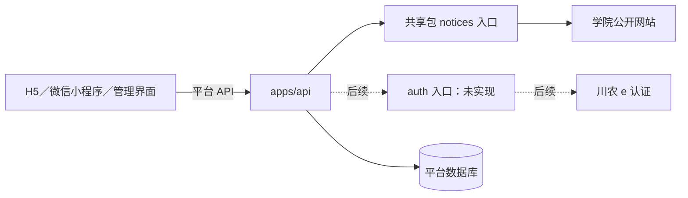

# 川农采集与认证共享包架构说明

- 状态：**公开通知内核已实现；认证入口仍待实现**。
- 确认日期：2026-10-24（Asia/Shanghai）。
- 说明记录：[Issue #127](https://github.com/HeHuoDa/HeHuoDa/issues/127)（架构说明，非开发任务）。
- 实施任务：[Issue #129](https://github.com/HeHuoDa/HeHuoDa/issues/129)（两院公开通知抽包）。
- 用途：记录共享包的现行职责与调用边界；认证部分为后续方向。

## 当前能力与目标

公开抓取与解析内核位于 `packages/sicau-connectors/src/notices`，API 的调度与持久化仍位于 `apps/api/src/ingestion`。当前仅接入信息工程学院、生命科学学院的公开 HTML 通知。采集生成候选和原文证据，经人工核对、导入及显式发布后，用户端通过比赛 API 查询正式数据；打开平台比赛详情不会每次触发官网爬取。

川农 e 认证模拟登录尚未验证完整链路、可信成功结果或稳定校园账号标识。本说明不代表学校认证已经接通，也不证明本科、当前在读、真实姓名或学校背书。

公开通知采集内核使用仓库内部私有 Node.js workspace 包；校园模拟登录适配后续按同一包的独立入口增量接入。27 院来源扩展继续由 [Issue #49](https://github.com/HeHuoDa/HeHuoDa/issues/49) 跟踪，抽包完成不等于完成学院覆盖。

## 包结构与使用范围

| 项目       | 已确认选择                                                      |
| ---------- | --------------------------------------------------------------- |
| 包名       | `@hehuoda/sicau-connectors`                                     |
| 目标位置   | `packages/sicau-connectors`                                     |
| 可见性     | `private: true`，首期不发布到 npm registry                      |
| 仓库内依赖 | 通过 `workspace:*` 声明                                         |
| 运行环境   | 服务端 Node.js，沿用项目运行环境约束                            |
| 公开入口   | `@hehuoda/sicau-connectors/notices`（已实现）；`/auth` 尚未导出 |
| 调用者     | `apps/api` 与仓库内 Node 工具                                   |

当前目录及后续入口：

```text
packages/sicau-connectors/
  src/notices/    已实现的公开通知抓取与解析
  test/           离线行为测试与构建入口测试
  dist/notices/   ESM JavaScript 与 .d.ts 构建产物（忽略）
  # src/auth/     后续川农 e 认证；当前无空实现或占位导出
```

`/notices` 导出来源、受控 HTTP、HTML 解析与候选类型，指向 ESM JavaScript 构建产物和类型声明，由调用方显式依赖；包不反向导入 `apps/api` 或其他 `apps/*` 的内部源码，不绑定 NestJS、数据库连接和平台账号模型。

## 界面与后端的调用关系



H5、小程序和管理界面不直接导入或执行爬虫。现有采集依赖 Node HTTPS、DNS 等服务端能力；抽包不会使这些能力变成浏览器或小程序 API。前端继续通过平台 HTTP 接口及生成类型获取数据，不持有学校 Cookie 或认证票据。

## notices：公开通知抓取与解析

包内职责：

- 经过核验的来源定义、学院适配器与页面选择器。
- 公开通知列表、分页、正文、发布日期和附件链接解析。
- 来源访问限制、请求预算、取消、响应大小和编码处理等抓取能力。
- 比赛候选字段、缺失信息、冲突提示及原文证据提取。
- 与公开接口对应的离线样本和维护型源码测试。

API 继续负责数据库锁、任务调度、游标和恢复链、运行记录、通知版本与候选持久化、人工审核、导入及显式发布。包返回上游内容和候选结果，不直接修改或发布正式比赛。

不把整个 `ingestion` 目录原样移动。`runner.ts`、`store.ts`、`review.ts` 保留数据库和业务流程。包自有学院目录与时间值类型，不引用 API 比赛模型；API 通过 `connector-adapter.ts` 显式转换目录与候选时间，再进入既有持久化及审核流程。API 自己保留摘要规范化算法，来源 ID、版本与去重算法不变。

现有两院规则需先回归，更多学院仍要逐站核对栏目、分页和正文。附件首期只记录链接，不因抽包扩大为自动 PDF、Word 或 OCR 解析；采集、候选与正式比赛继续分离，参见 [ADR 0004](adr/0004-official-notice-ingestion.md)。

## auth：川农 e 认证模拟登录

学校正式第三方接入不可用，已选路线为：小程序原生表单收集用户输入，经平台后端模拟川农 e 认证正常网页登录。学校应用注册、OAuth/CAS 回调或官方开放 API 不作为本路线的开工前置。

包内拟负责：

1. 初始化一次独立的学校登录会话及正常页面所需参数。
2. 在该会话中获取、刷新图形验证码。
3. 用户手动填写验证码后，按正常请求规则提交账号、密码及答案。
4. 依据可信登录响应或同一学校会话下的身份查询结果，确认成功并提取稳定账号标识。
5. 在取消、超时、失败或完成后销毁临时学校会话。

实际地址、参数、正常页面加密规则、重定向范围及成功判据需要真实验证，不能通过猜字段实现。仅有 HTTP 200、页面跳转、自填学号、截图或客户端成功标记不能证明核验成功。

平台用户归属、核验事务、限频、审计、校园身份 HMAC 索引、唯一绑定、学期有效期、平台会话和业务权限继续由 API 负责。包只返回必要的学校认证结果，不直接授予平台权限或签发平台令牌。

用户需要明确知道校园密码会经过平台后端短时处理；不保存密码，不自动识别或绕过验证码，不绕过访问限制或额外二次认证，不进入 VPN/教务抓取成绩、课表或完整资料。技术成功不等于取得学校授权或已经满足正式开放条件。

## 两个入口的隔离约束

- Cookie 容器和临时会话按认证事务隔离，不跨用户共享，也不与公开通知采集共用。
- 认证密码、验证码答案、Cookie、票据及敏感原始响应不进入公开采集存储、数据库、日志、追踪、错误报告或持久队列。
- 公开网页采集的重试规则不适用于密码提交；认证提交不自动重放。
- 两类来源分别限定域名、重定向、响应格式和访问规则，不通过放宽公共白名单来兼容登录流程。
- 无状态的取消、响应大小限制等工具可按实际需要复用，首期不新增第三个通用爬虫核心包。

当前 [HTTP 采集实现](../packages/sicau-connectors/src/notices/http.ts) 没有完整的 POST 请求体与认证 Cookie 容器能力，并有公开采集专用的响应头处理及有限重试；[持久化实现](../apps/api/src/ingestion/store.ts) 会保存公开通知原始响应。因此不能把现有公开采集 HTTP/存储链直接用于学校认证。

## 后续实施前置与验证

公开通知抽包仅覆盖现有两院，以离线测试和隔离数据库验证解析、证据、去重、版本、续跑、审核与发布行为。数据库和正式比赛查询契约不因抽包改变。

认证入口先完成实际后端环境可达性、同会话验证码、真实成功结果、稳定账号标识和小程序承接验证；真实账号测试需要单独授权且由用户手填验证码。无法可靠确认成功或取得稳定标识时，不启用正式校园核验，不用前端自报或页面提示代替。

后续实现须验证包入口可独立构建和加载，不反向依赖应用内部模块，前端依赖图不包含服务端运行时代码。CI 使用离线样本和受控替身，真实学院网站、学校登录、小程序运行及生产证据分别记录。

Issue #129 不实现 `/auth`、学校登录、管理 HTTP 路由或数据库迁移，也不执行生产部署。认证任务按各自范围实施。

## 构建与调用

- 独立构建／检查：`pnpm --filter @hehuoda/sicau-connectors build`、`typecheck`、`lint`、`test:unit`。
- API 显式依赖 `workspace:*`。API 的开发／启动、编译、类型检查、测试、OpenAPI 与各 CLI 脚本均先构建此依赖，所以清洁安装后不要求手工准备 dist。根递归脚本按 workspace 依赖排序运行；CI 的 `api:generate` 在根 `build` 前也可运行。
- Docker 复制新包清单与源码，通过 API 构建前置步骤产出包；`pnpm deploy` 将仅含 dist 的生产包和 Cheerio 依赖带入运行镜像。镜像 smoke 在容器中从公开入口解析离线候选，不访问官网。
- Node 调用示例：`import { sources, BoundedFetcher, extractArticle, parseCandidate } from "@hehuoda/sicau-connectors/notices"`。先核对 robots，再按原有请求预算抓取；参数、返回类型见构建声明。
- 关闭调度后可回退至兼容的 API／包版本，不清空通知、候选、游标、版本或正式比赛。前端只使用原平台 API，没有本包的服务端依赖。H5／小程序交互、真机和生产未因此获得新增验收证据。
